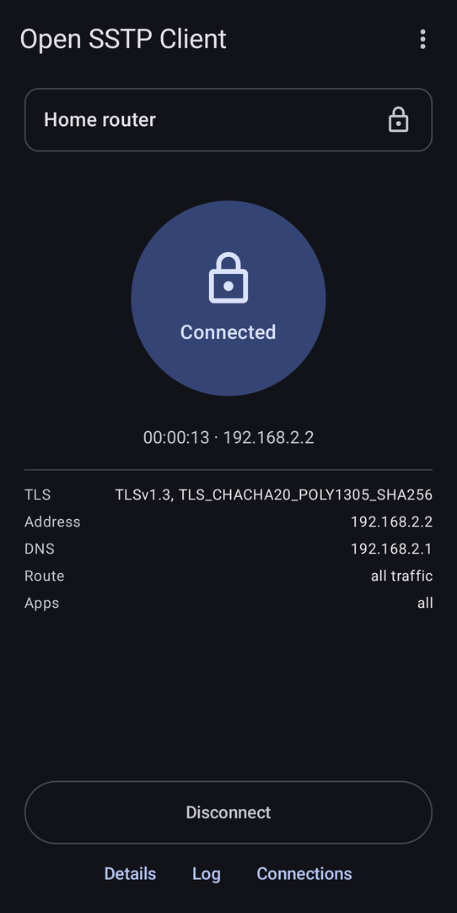
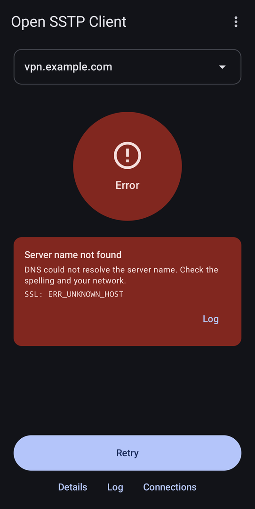
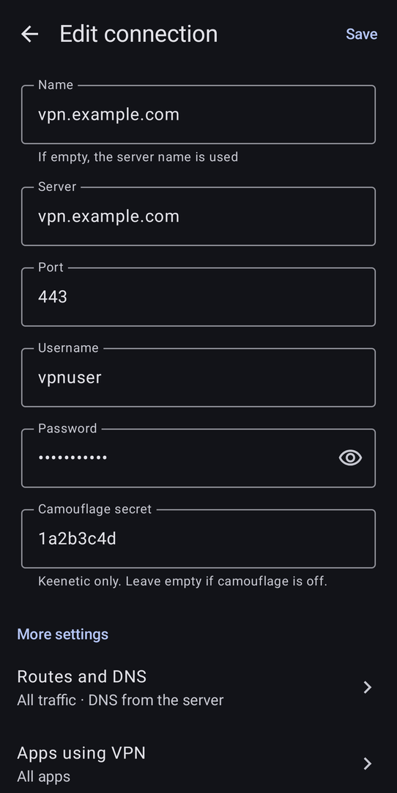
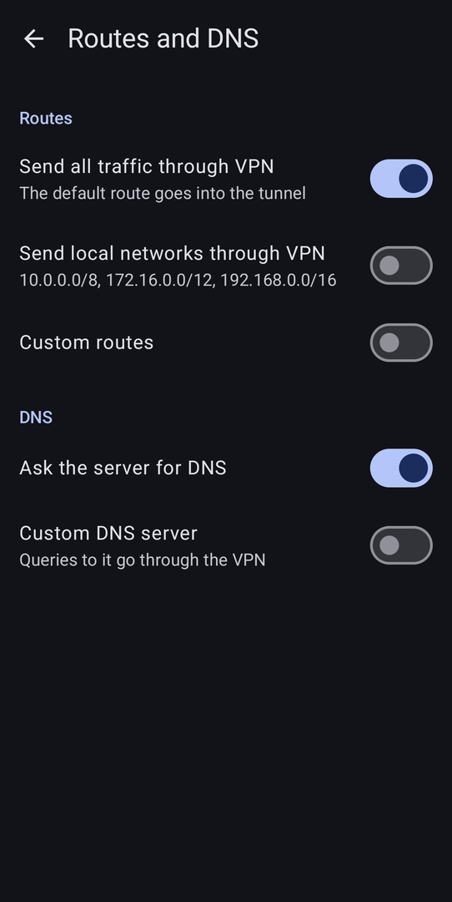
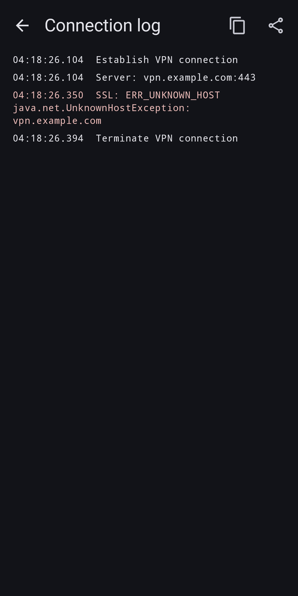

# Homeward SSTP 

Homeward SSTP is a fork of [kittoku/Open-SSTP-Client](https://github.com/kittoku/Open-SSTP-Client), an open-source
Secure Socket Tunneling Protocol (MS-SSTP) client for Android. The fork replaces the preference screens with
a new Jetpack Compose + Material 3 interface (English and Russian) and adds connection profiles, an in-app
connection log, readable error messages, support for the Keenetic camouflage secret, and fixes in
`SSLTerminal` (a socket connect timeout, an endless loop on EOF in the proxy response, separate error codes
for connection failures). It is built and tested against a home Keenetic router.

The protocol core — SSTP, PPP, TLS and authentication — is the work of
[KOBAYASHI Ittoku](https://github.com/kittoku) and the
[contributors](https://github.com/kittoku/Open-SSTP-Client/blob/main/CONTRIBUTORS.md) of the original
project. This fork only adds an interface and a few fixes on top of it. If you need the original app, get
it from [Google Play](https://play.google.com/store/apps/details?id=kittoku.osc) or the
[upstream releases page](https://github.com/kittoku/Open-SSTP-Client/releases).







## Usage

### Create a connection
On first start, tap `Create connection` and fill in:

* `Server` — the host name or IP address only, without `https://`, a path or a port
* `Port` — 443 unless the server uses another one
* `Username` and `Password`
* `Camouflage secret` — optional, Keenetic only (see [below](#keenetic))

`Name` is optional; if it is empty, the server name is used. Under `More settings` there are
`Routes and DNS`, `Apps using VPN` (all apps, only selected apps, or all except selected) and `Advanced`
(TLS version, server name verification, SNI, cipher suites, custom trusted certificates, PPP authentication
methods, MRU/MTU, IPv4/IPv6, HTTP proxy, reconnection, saving the log to a file).

### Connect
The home screen shows the selected connection, its state and a `Connect` / `Disconnect` button. The first
connection asks Android for the VPN permission. If a connection fails, the home screen shows what went
wrong (wrong credentials, untrusted certificate, server not reachable, TLS handshake stalled, not an SSTP
server, and so on) with a hint and a link to the log.

Below the button:

* `Details` — the established connection: TLS version, address, DNS, routes, apps
* `Log` — the connection log of the recent attempts; it can be copied or shared
* `Connections` — the list of connections: add, edit, duplicate, delete, export to a file and import from
  one. An exported file contains the password in plain text.

You can also switch between connections from the dropdown at the top of the home screen. The `⋮` menu
opens `About` with the version, links and credits.

### Quick settings tile
Add the app's tile (it carries the app name, "Homeward dev" for a debug build) to quick settings to connect and disconnect without opening the app. If
the VPN permission has not been granted yet or the selected connection is not complete, the tile opens the
app instead.

## Keenetic
* KeenDNS must be in **Direct access** mode. In cloud mode some mobile networks block the Keenetic
  cloud servers, and the TLS handshake times out over mobile data while it works over Wi-Fi.
* If camouflage is enabled for the SSTP server on the router, Keenetic shows the server address with a
  `?` and a secret after it. Put the host name into `Server` and the part after `?` into
  `Camouflage secret`. For example, for `myrouter.keenetic.pro?1a2b3c4d` enter `myrouter.keenetic.pro` as
  the server and `1a2b3c4d` as the secret. Leave the secret empty if camouflage is off.
* A KeenDNS certificate is issued by Let's Encrypt and is trusted by Android as is; no extra certificate
  setup is needed.

## Notes
* The server must assign the client an IP address.
* Authentication methods: PAP, MS-CHAPv2 and EAP-MSCHAPv2.
* A server with a self-signed certificate needs the certificate in a folder selected under
  `Advanced` → `Custom trusted certificates`, or server name verification turned off if the certificate
  is issued for another name.
* The IPv6 option only gives the device a link-local address.

## Building
Requirements: JDK 21 and the Android SDK (the command-line tools are enough; the project compiles against
API 36). Create `local.properties` in the repository root pointing to the SDK:

```properties
sdk.dir=C\:\\Users\\you\\AppData\\Local\\Android\\Sdk
```

Then:

```bash
./gradlew assembleDebug
```

The APK is written to `app/build/outputs/apk/debug/app-debug.apk`. The release build has the application ID
`io.github.vgdotnet.osc` and the label "Homeward"; the debug build adds `.dev` and the label "Homeward dev",
so both install next to each other and next to the original app from Google Play (`kittoku.osc`).
Unit tests:

```bash
./gradlew testDebugUnitTest
```

On Windows use `gradlew.bat` (or `gradlew` from `cmd`).

## License
Licensed under MIT, the same terms as the upstream project; see [LICENSE](LICENSE). Use this software at
your own risk.
